<a href="https://ilovetests.hatemsoliman.dev">
  <picture>
    <source media="(prefers-color-scheme: dark)" srcset="docs/readme/banner-dark.png">
    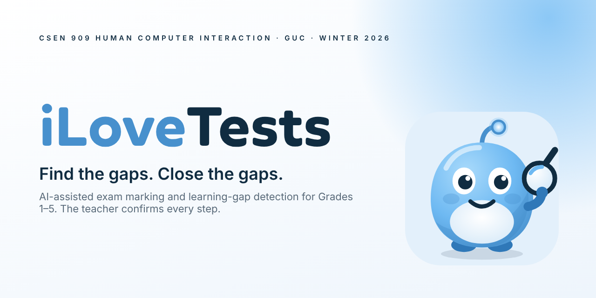
  </picture>
</a>

<p align="center">
  <a href="https://ilovetests.hatemsoliman.dev"><b>Open the app</b></a> ·
  <a href="#run-it-locally">Run locally</a> ·
  <a href="#deploy-your-own">Deploy</a> ·
  <a href="https://github.com/CodeNKoffee/csen909-ilovetests/wiki">User guide</a>
</p>

<p align="center">
  <a href="CHANGELOG.md"></a>
  <a href="LICENSE"></a>
  
  
  
  
</p>

<p align="center">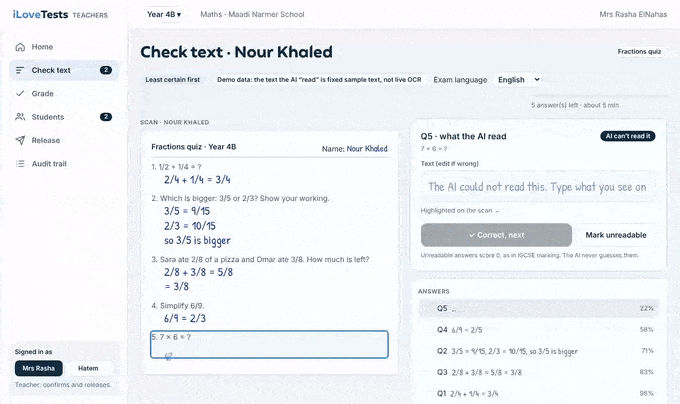</p>
<p align="center"><i>The AI reads and suggests. Mrs Rasha checks, corrects and confirms.</i></p>

## The trailer

Marking handwritten exams for young children takes days, and the same mistakes get lost in chats.
iLoveTests reads a photo of the pupil's paper and suggests marks for each step of the mark scheme.
**The teacher confirms every step** before a child sees anything.
Then the pupil gets kind, specific feedback and practice on exactly what she missed.

| | |
|---|---|
| 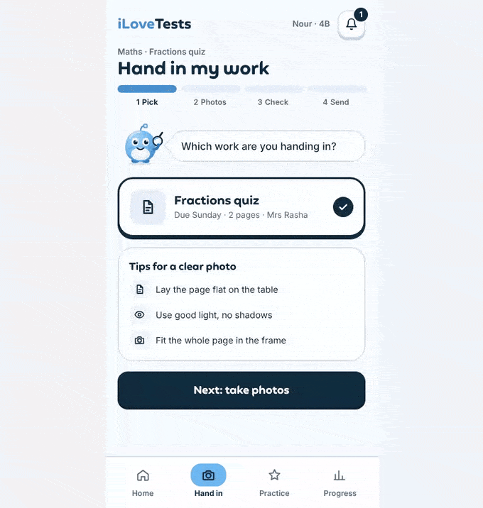<br>**Hand in with a blur check.** A blurry page is caught before it reaches the teacher. | <br>**Check, then grade.** Least certain answers first; every AI mark can be changed. |
| 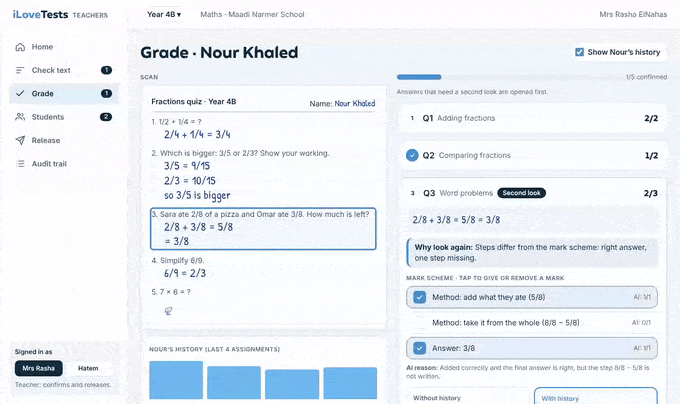<br>**Find the gap.** Red flags with evidence, a Learning Timeline and class-wide mistakes. | 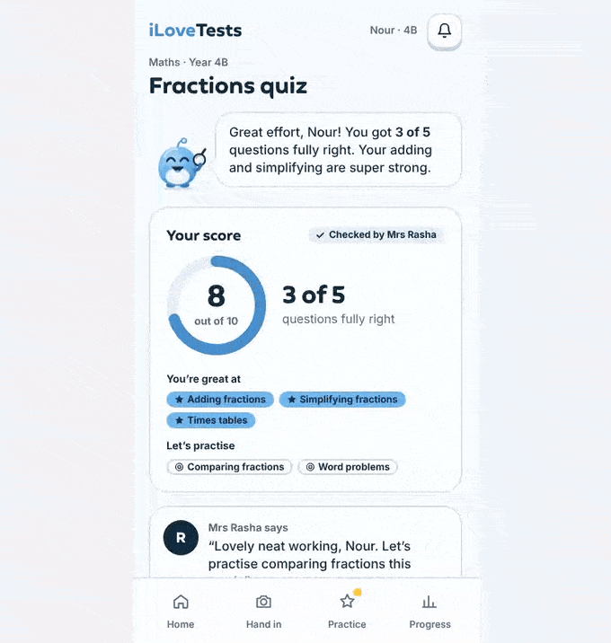<br>**Close the gap.** Praise first, "Not yet" instead of a cross, then practice. |

<details>
<summary><b>Contents</b></summary>

- [Features](#features)
- [Screens](#screens)
- [How it works](#how-it-works)
- [Your data](#your-data)
- [How it's built](#how-its-built)
- [Run it locally](#run-it-locally)
- [Deploy your own](#deploy-your-own)
- [Project structure](#project-structure)
- [Regenerating the media](#regenerating-the-media)
- [Roadmap](#roadmap)
- [Contributing](#contributing)
- [Team](#team)
- [Licence and credits](#licence-and-credits)

</details>

## Features

| View | What you can do |
|---|---|
| **Student** | Home with Lukki the mascot · 4-step photo hand-in with a blur check · results with "Got it" / "Not yet" and "How to fix it" · practice that is never marked · progress |
| **Teacher** | Batch overview · text check, least certain first, in English and German · AI marks per mark-scheme step with a reason · confirm or override · history switch · comments · red flags with evidence · Learning Timeline · Concept Links · class-wide announcements · release · audit trail |
| **Assistant** | Checks text and drafts grades · cannot confirm, decide red flags or release |
| **Parent** (bonus) | Weekly digest of confirmed results, in kind words, with how to help at home |
| **Testers** | A demo guide walks through all 8 steps; **Reset demo** starts again |

## Screens

| | |
|---|---|
| 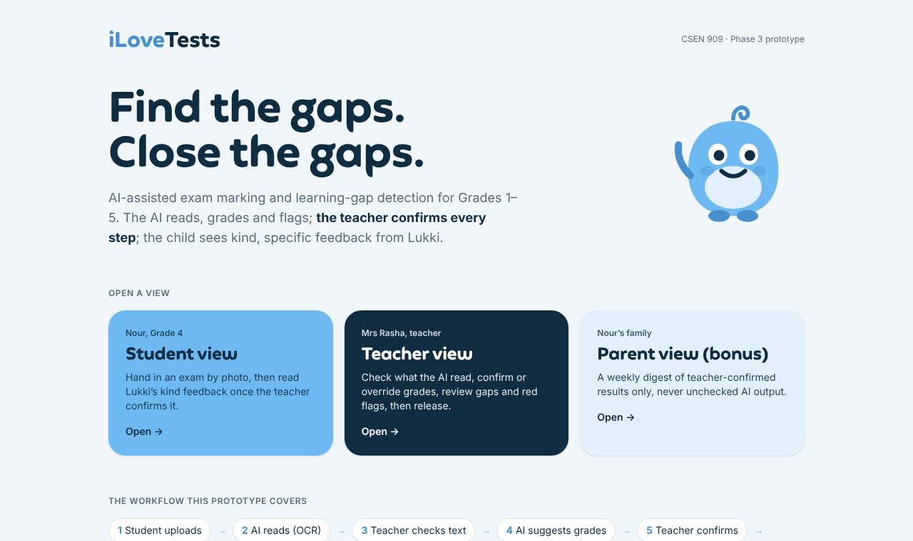<br>Start page | 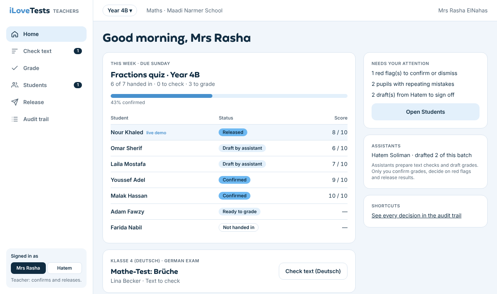<br>Teacher home |
| 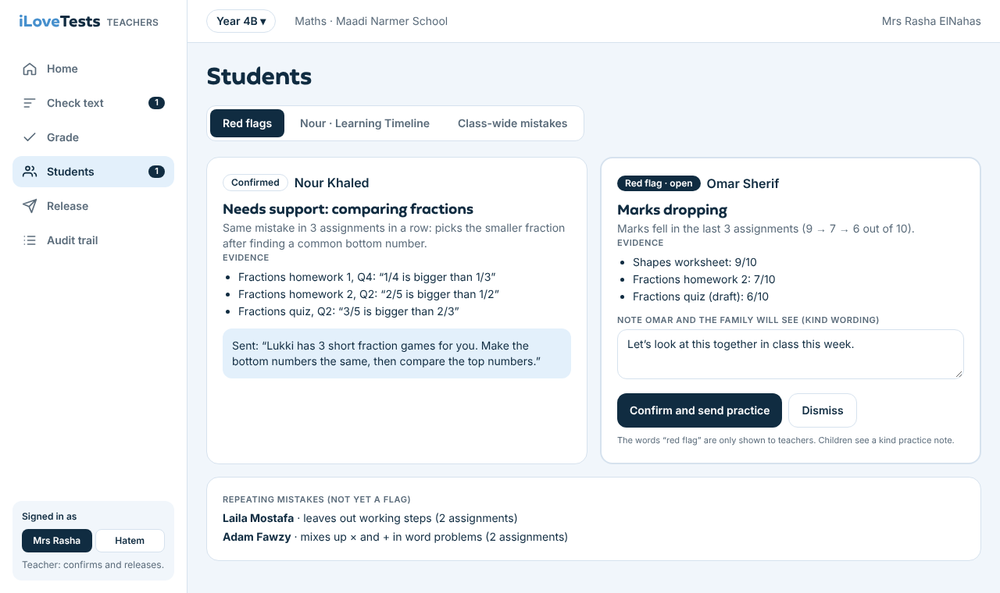<br>Learning Timeline | 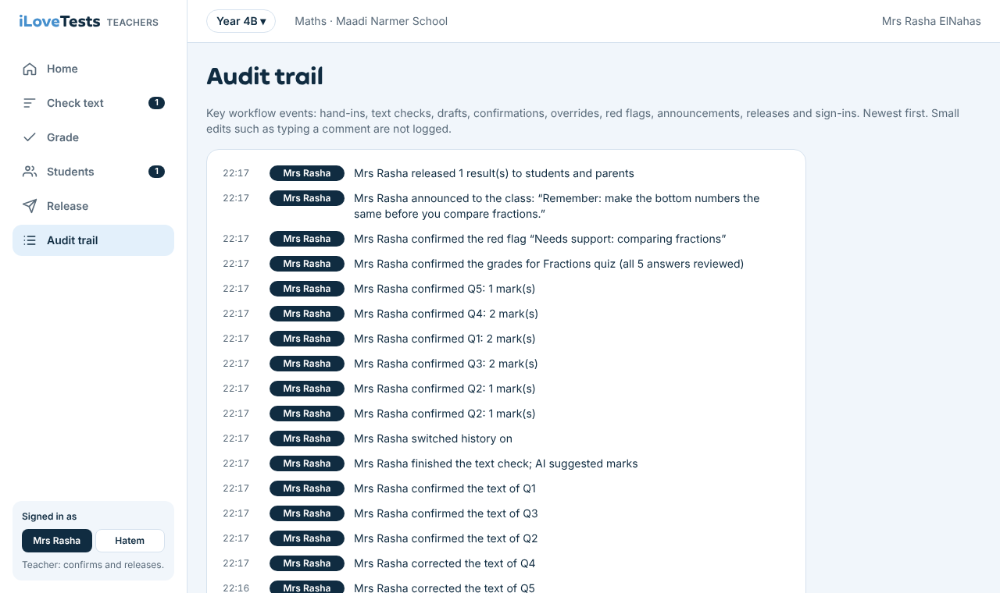<br>Audit trail |
| 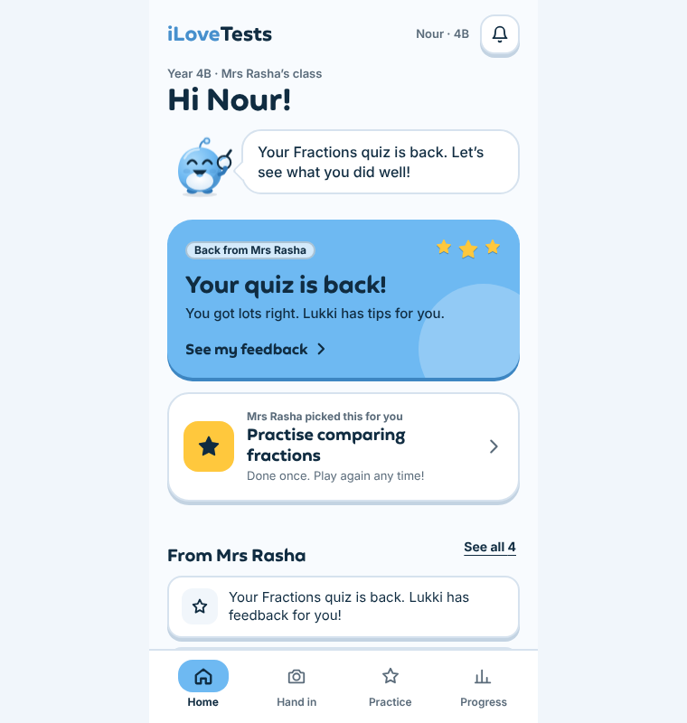<br>Student home | 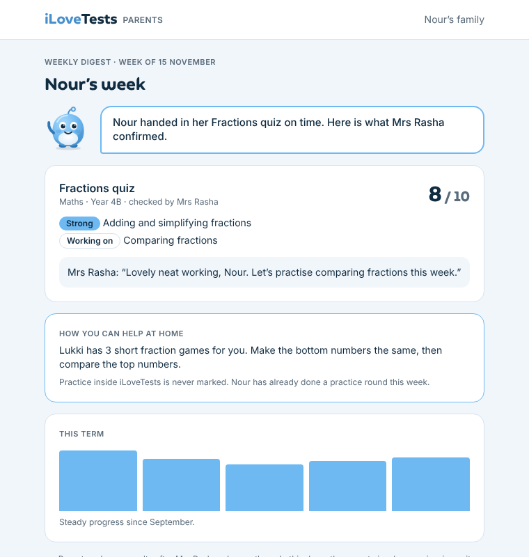<br>Parent digest |

## How it works

<picture>
  <source media="(prefers-color-scheme: dark)" srcset="docs/readme/workflow-dark.png">
  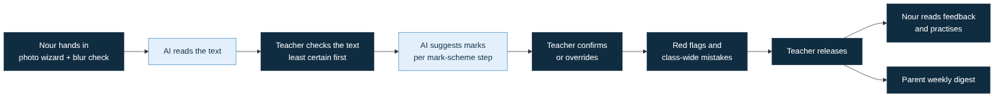
</picture>

Light boxes are what the AI suggests. Dark boxes are people. Nothing reaches a pupil or parent until the teacher releases it.

## Your data

- There is no server, no account and no tracking.
- Demo progress lives in your browser's local storage (`ilovetests-demo-v1`). **Reset demo** clears it.
- Every pupil, mark and AI output is fictional, fixed data in [`lib/data.ts`](lib/data.ts), as our course brief allows. No live AI model runs in the app.

## How it's built

| Part | Choice |
|---|---|
| Framework | [Next.js 16](https://nextjs.org) App Router, exported as a static site |
| UI | React 19, TypeScript 5.9, Tailwind CSS 4 |
| State | React context and a reducer, saved to local storage |
| Fonts | Inter, Nunito and Patrick Hand via Fontsource (SIL OFL); Feather Bold if installed |
| Hosting | Vercel, with security headers in [`vercel.json`](vercel.json) |

## Run it locally

You need Node.js 20 or newer.

```bash
git clone https://github.com/CodeNKoffee/csen909-ilovetests.git
cd csen909-ilovetests
npm install
npm run dev        # http://localhost:3000
```

Build and serve the static site:

```bash
npm run build      # writes ./out
npm start          # serves ./out on http://localhost:3000
```

Then follow the demo guide in the bottom-right corner.

## Deploy your own

**Vercel:** import the repository at [vercel.com/new](https://vercel.com/new) and keep the defaults.

**GitHub Pages:** build with `NEXT_PUBLIC_BASE_PATH=/csen909-ilovetests npm run build` and publish the `out` folder.

## Project structure

```
app/                 pages: /, /student/*, /teacher/*, /parent
components/          shells, Lukki, simulated scan, UI parts, demo guide
lib/data.ts          fictional exams, pupils and AI output
lib/store.tsx        shared demo state
lib/labels.ts        status labels
public/              icons, og.png, manifest, robots, sitemap, llms.txt
docs/readme/         README images (generated)
docs/wiki/           user guide, published to the GitHub wiki
docs/htd/            hierarchical task designs (Phase 3)
docs/sketches/       hand-drawn storyboard (Phase 3)
scripts/             media and wiki scripts
```

## Regenerating the media

Every GIF and screenshot is recorded from the real app.

```bash
npm i -D playwright && npx playwright install chromium   # once
npm run build && npx serve out -l 4173 &
node scripts/readme-media.mjs
```

It also needs `ffmpeg`, `gifsicle` and `mmdc` ([Mermaid CLI](https://github.com/mermaid-js/mermaid-cli)). The workflow diagram source is [`scripts/readme/workflow.mmd`](scripts/readme/workflow.mmd).

## Roadmap

- Typed answers as well as photos
- Teacher-uploaded mark schemes and assignment schedule
- Usability testing with primary pupils, parents and teachers
- A real reading and grading model behind the same confirm-every-step flow

## Contributing

Issues and pull requests are welcome. Read [CONTRIBUTING.md](CONTRIBUTING.md), add a line to [CHANGELOG.md](CHANGELOG.md), and report security problems privately as described in [SECURITY.md](SECURITY.md).

## Team

Team iLoveTests, CSEN 909 Human Computer Interaction, German University in Cairo, Winter 2026.

| Name | Tutorial |
|---|---|
| Hatem Yasser Soliman (scrum master) | 2 |
| Mohammed Ahmed Elazab | 4 |
| Ahmed Hassan Abdelbarr | 7 |
| Youssef Hesham | 7 |
| Tony Makaryous | 12 |

Course: Dr. Aya Salama. TAs: Samaa Soliman and Aml Yasser.
Teacher persona: Mrs Rasha ElNahas, Maadi Narmer School, used with her permission. Nour Khaled and the other pupils are fictional.

## Licence and credits

Code: [MIT](LICENSE). Lukki, the mascot, is our own design.

Inter, Nunito and Patrick Hand are used under the SIL Open Font Licence via Fontsource.
Our headings use Duolingo's Feather Bold (Fontsmith End User Licence Agreement). Its licence does not allow us to publish the font file, so it is not in this repository; the site uses it only if it is installed on your computer and falls back to Inter otherwise.

We wrote this prototype with help from Claude (Cowork) and reviewed, tested and edited all of it. The full AI history is linked in our Phase 3 report.
