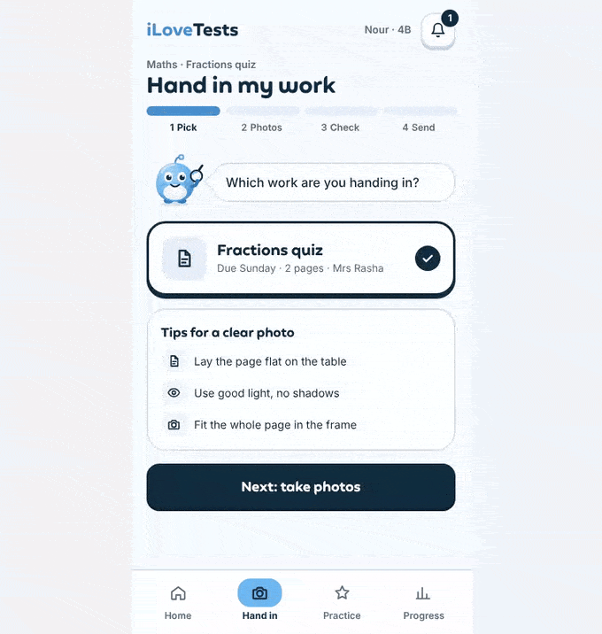

# Getting started

1. Open [the app](https://ilovetests.hatemsoliman.dev). A private or incognito window is fine; there is no sign-in.
2. Follow the **Demo guide** card in the bottom-right corner. It shows the next step and how far you are (for example *Demo guide · 3/8*). On a phone it is a small button such as **Demo 3/8 · next →**.
3. Tap the dark button in the card to jump to the next step. **All steps** shows the full list.

The eight steps:

1. Nour hands in her Fractions quiz (student)
2. Mrs Rasha checks the text the AI read (teacher)
3. The AI suggests grades; the teacher confirms or overrides (teacher)
4. Review the learning gap and the red flag (teacher)
5. Release results to Nour and her parents (teacher)
6. Nour reads Lukki’s feedback (student)
7. Nour practises comparing fractions (student)
8. Her parent reads the weekly digest (parent)

To start again, press **Reset demo** in the guide, then **Yes, reset**. See [[Your Data and Reset]].

