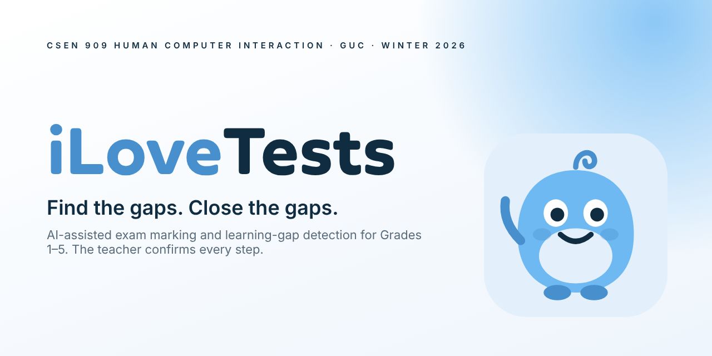

# iLoveTests user guide

**Find the gaps. Close the gaps.** AI-assisted exam marking and learning-gap detection for Grades 1–5, where the teacher confirms every step.

[Open the app](https://ilovetests.hatemsoliman.dev) · [Source code](https://github.com/CodeNKoffee/csen909-ilovetests) · [Report a bug](https://github.com/CodeNKoffee/csen909-ilovetests/issues/new?template=bug_report.md)

| If you want to… | Read |
|---|---|
| Try the whole flow in five minutes | [[Getting Started]] |
| Hand in work and read feedback as a pupil | [[Student View]] |
| Check text, grade, review gaps and release | [[Teacher View]] |
| See what an assistant can and can't do | [[Assistant Role]] |
| See the parent digest | [[Parent View]] |
| Understand where demo data lives or start again | [[Your Data and Reset]] |
| Run or deploy your own copy | [[Self Hosting]] |
| Help improve it | [[Contributing]] |
| Quick answers | [[FAQ]] |

**What's new:** version 1.0.0, the first public release. See the [changelog](https://github.com/CodeNKoffee/csen909-ilovetests/blob/main/CHANGELOG.md).
