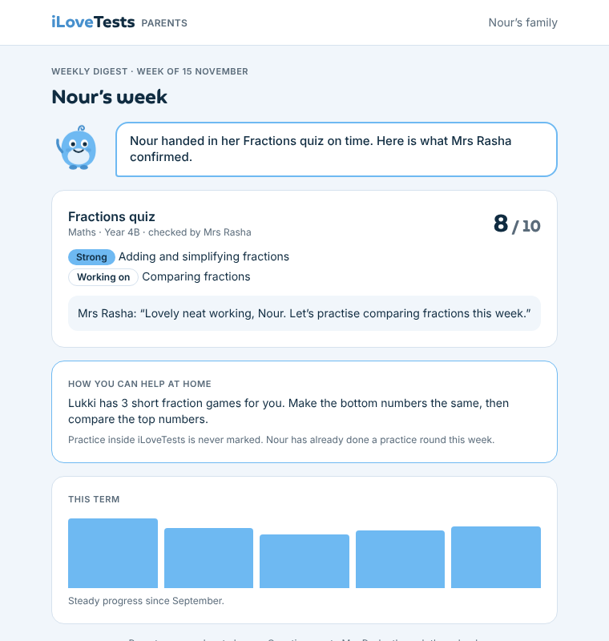

# Parent view

Open **Parent view (bonus)**, or go to `/parent/`.

- A weekly digest with confirmed results only. Nothing unchecked by the teacher appears.
- *Strong* and *Working on* skills in plain words, and Mrs Rasha's general comment.
- **How you can help at home** appears when the teacher confirms a practice note.
- Parents can read, not change.

