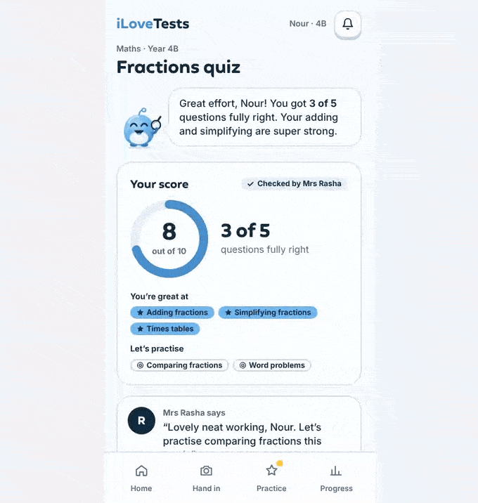

# Student view

Open **Student view** on the start page, or go to `/student/`. On a laptop it shows inside a phone frame.

## Hand in work
1. On Home, Lukki tells Nour what is due. Tap **Hand in my work**.
2. The wizard has four steps: **Pick**, **Photos**, **Check**, **Send**.
3. Tap the round shutter once per page. The demo makes page 2 blurry on purpose.
4. On **Check**, Lukki asks for a retake. Tap **Take page 2 again**, take it, then **Next: send** and **Send to Mrs Rasha**.

## Read results
Results appear only after the teacher releases them. Until then Lukki says the quiz isn't back yet.
- Praise comes first, then the score, *Checked by Mrs Rasha*.
- Each question shows **✓ Got it** or **Not yet**. **How to fix it →** opens the worked method.

## Practise
If the teacher confirms a red flag, a **Practice for you** card appears. Tap a fraction to choose the bigger one. A wrong answer shows *Not yet!* and a tip, with **Try again**. Practice is never marked.

## Progress
**Progress** shows a bar for each exam this year and the skills that are getting stronger.

