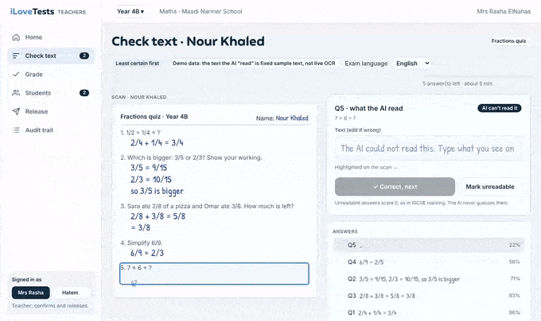

# Teacher view

Open **Teacher view**, or go to `/teacher/`. The side menu has **Home**, **Check text**, **Grade**, **Students**, **Release** and **Audit trail**. Numbers next to an item show work waiting.

## Home
The Fractions quiz batch for Year 4B: who handed in, what to check and what to grade, with a button for the next action. A German exam (Lina, Klasse 4) is listed below.

## Check text
The scan sits on the left, the AI reading on the right, least certain answer first.
- Edit the text if it is wrong, then **✓ Save correction, next**. If it is right, **✓ Correct, next**.
- **Mark unreadable** scores the answer 0, as in IGCSE marking. The AI never guesses.
- When all answers are checked, **Send to AI grading →**.

## Grade
- Answers marked **Second look** open first, with *Why look again*.
- Tap a mark-scheme step to give or remove its mark. The AI's suggestion and reason stay visible.
- **Show Nour’s history** compares the suggestion with and without her past work. History never changes marks.
- **Not in the mark scheme** sends the answer to your own judgement.
- Edit the suggested comment, add a general comment, then **Confirm all grades**.

## Students
- **Red flags**: evidence from several assignments. Edit the kind note the pupil and family will see, then **Confirm and send practice** or **Dismiss**.
- **Nour · Learning Timeline** and **Concept Links** show where a gap began and where it shows up next.
- **Class-wide mistakes**: **Announce to Year 4B** posts one class note with no names.

## Release and audit trail
**Release** sends confirmed results only, to pupil and parent together. **Audit trail** lists the key workflow events: hand-ins, text checks, drafts, confirmations, overrides, red flags, announcements, releases and sign-ins. Small edits such as typing a comment are not logged.

